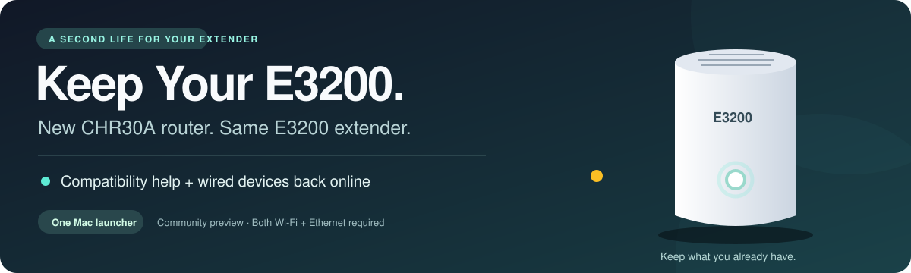

  <a href="https://github.com/travismansook/e3200-chr30a-helper/releases/latest"><strong>Download for Mac</strong></a>
  &nbsp; · &nbsp; <a href="docs/setup.md">Getting started</a>
  &nbsp; · &nbsp; <a href="docs/faq.md">FAQ</a>
  &nbsp; · &nbsp; <a href="docs/behind-the-scenes.md">Behind the scenes</a>

# Keep Your E3200

**Switched to a Verizon CHR30A? Keep your E3200—and get its wired devices online again.**

I started this project after upgrading my main router from a **CR1000A to a CHR30A**. I wanted to keep using my **E3200 extender connected over coax**, but the equipment no longer worked together as expected.

My E3200 cycled through a yellow-light problem. **When it turned yellow, it lost its internet connection, causing devices connected through it to disconnect.** My earlier logs showed the recovery cycle repeating roughly every **three minutes**, with most interruptions lasting **9–11 seconds**. Its settings page was unreliable. Later, devices connected by Ethernet through the extender could get IPv6 but missed the IPv4 address they needed—so some sites worked and others failed.

**I brought the two workarounds that helped on my network into one launcher.**

**Get back into your E3200's network settings.** Once the extender accepts its IPv4 address, you can open its settings page in a browser at the address you chose during setup. The helper addresses the missing-address problem that made that page unreachable.

## Two problems. One helper.

| What you notice | What the helper does |
| --- | --- |
| **The E3200 turns yellow and loses internet access, causing disconnects, or its settings page will not open** because it rejects the router's address offer. | Gives the E3200 an address offer with the compatibility information it expects, restoring access to its network settings page at its accepted IPv4 address. |
| **Ethernet devices say connected, but cannot reach some sites**, and do not get a usable IPv4 address automatically. | Gets their address requests through to the CHR30A and sends the router's replies back to the wired side. |

Your CHR30A stays the main router. Your devices' normal internet traffic keeps using the network directly. The helper handles address messages; it does not put all your traffic through the Mac.

> **A workaround, with clear limits.** This targets the two address-assignment problems described above. It is not a firmware upgrade or a fix for every yellow light. The combined workaround worked with my Mac and Stream TV; the reusable release needs testing in more homes. [What has been tested →](docs/validation.md)

## Download. Open. Follow the questions.

### 1 · Download the right Mac file

**[Get the executable from Releases →](https://github.com/travismansook/e3200-chr30a-helper/releases/latest)**

Choose **Apple Silicon** for an M-series Mac or **Intel** for an Intel Mac. Requires **macOS 15 or later**. The ZIP contains one file: **Keep Your E3200.command**. No building, Python installation, or code editing is needed.

### 2 · Connect the Mac both ways

Connect it to **your home Wi-Fi**, and plug its **Ethernet cable directly into an Ethernet port on the E3200**. Keep the extender's existing coax connection to the router.

**Coax requirement:** the main CHR30A needs its **MoCA Expansion Module** installed. The E3200 cannot connect wirelessly back to the CHR30A; this tested setup uses coax between them. It still provides Wi-Fi to your devices. [Connection requirements →](docs/faq.md#what-do-i-need-to-connect-the-e3200-over-coax)

### 3 · Open the helper

Unzip the download and double-click **Keep Your E3200.command**. The guided setup reads your connections and asks for your E3200's MAC address and an unused address you have set aside on the router. It requests administrator access when needed.

Wait for **“READY: E3200 and Ethernet helpers are running.”** Leave the window open and the Mac awake. Press **Ctrl+C** to stop both helpers.

**[First-time setup, including Mac's download warning →](docs/setup.md)**

## Do I need to leave it running?

**Yes—plan to keep the helper running and its host awake, with both connections available.** Devices can need it when they first connect, renew their addresses, restart, or lose a lease. They may keep working for a while after it closes, but that is not a permanent fix.

An existing spare Mac can be a practical host. A small Linux computer or **Raspberry Pi** could be a future always-on option, but **this Mac download will not run on a Pi**. Windows, Linux, and Raspberry Pi support are planned for later; they are not included in this release.

**[Read the FAQ: leases, power, speed, and always-on options →](docs/faq.md)**

## Which project should I use?

This is the **combined compatibility + Ethernet helper for Mac**. My earlier [E3200 DHCP Helper](https://github.com/travismansook/e3200-dhcp-helper) focuses on the extender's own address/compatibility problem and has separate Windows, Mac, and Linux workflows. Those platform downloads do not contain this new Ethernet forwarder.

Run only one applicable helper at a time. If you already use the earlier program, stop it before starting this one.

## Want the story—or the details?

- **[FAQ](docs/faq.md)** — answers without the networking jargon.
- **[Setup guide](docs/setup.md)** — what to connect, what to enter, and how to stop.
- **[Troubleshooting](docs/troubleshooting.md)** — what to check when something does not work.
- **[Behind the scenes](docs/behind-the-scenes.md)** — the DHCP behavior, design, source, and developer instructions.
- **[Validation record](docs/validation.md)** — observed results and what still needs field testing.
- **[Project story](docs/project-story.md)** — why I made this and how the investigation became this tool.
- **[Roadmap](docs/roadmap.md)** — Windows, Linux, and Raspberry Pi plans.

This project is independent of Verizon. Verizon currently [does not support pairing the CHR30A with previous-generation extenders](https://www.verizon.com/support/residential/internet/equipment/routers/wi-fi-access-point). The helper does not turn it into a fully supported Verizon mesh system.

Original code: [MIT license](LICENSE). Bundled components retain their [own licenses](THIRD-PARTY-NOTICES.md).
