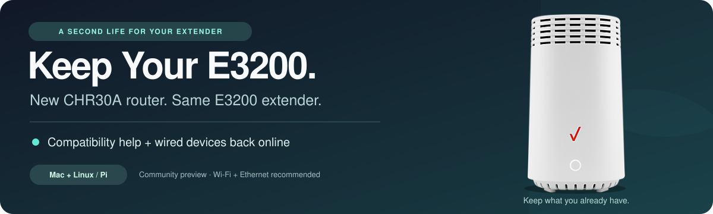

  <a href="https://github.com/travismansook/keep-your-e3200/releases/latest"><strong>Download for Mac</strong></a>
  &nbsp; · &nbsp; <a href="https://github.com/travismansook/keep-your-e3200/releases/tag/linux-v0.1.0-preview4"><strong>Download for Linux / Raspberry Pi</strong></a>
  &nbsp; · &nbsp; <a href="docs/faq.md">FAQ</a>
  &nbsp; · &nbsp; <a href="docs/behind-the-scenes.md">Behind the scenes</a>

# Keep Your E3200

**Switched to a Verizon CHR30A? Keep your E3200—and get its wired devices online again.**

## Why keep it?

**Your old E3200 can become an extra Wi-Fi coverage point after your router upgrade.** Put it to work in another room, keep its Ethernet ports useful, and get more use out of hardware you already have.

That is a big part of why I wanted to keep mine. If Verizon replaces your old extender with **another CHR30A acting as an access point at no extra charge** and lets you keep the E3200, you can use the replacement **and** put the retained E3200 back to work as an additional extender. Confirm replacement costs and whether you can keep the old equipment with Verizon for your account.

## Why I made this

After upgrading my main router from a **CR1000A to a CHR30A**, I wanted to keep my **E3200 connected over coax**. Instead, it repeatedly turned yellow, lost internet access, and disconnected the devices using it. My earlier logs showed the recovery cycle roughly every **three minutes**, with most interruptions lasting **9–11 seconds**. I also couldn’t open the E3200’s network settings at its IP address.

Later, Ethernet devices could get IPv6 but missed the IPv4 address they needed. Some sites worked; others would not load.

**One helper addresses both problems:**

| What you notice | What the helper does |
| --- | --- |
| **The E3200 turns yellow and disconnects, or you cannot open its settings page**, because it rejects the router's address offer. | Gives the E3200 an address offer with the compatibility information it expects. Once it accepts the address, its network settings page becomes reachable at that address again. |
| **Ethernet devices say connected but cannot reach some sites**, and do not receive a usable IPv4 address automatically. | Gets their address requests through to the CHR30A and returns the router's replies to the wired side. Devices keep using automatic addressing. |

Your CHR30A stays the main router. The helper handles address messages; your normal downloads, video and games do not pass through the helper computer.

> **A community workaround.** This targets the address-assignment problems I experienced. It is not a firmware upgrade or a repair for every yellow light or Wi-Fi disconnect. I tested the original workaround with wired devices on my own network. The Linux preview has initial Raspberry Pi testing; broader testing is still needed. [What has been tested →](docs/validation.md)

## Choose your download

**No building or compiling is needed.** Mac and Linux/Pi live in this same project, with separate downloads and instructions.

| Your computer | Download | Start here |
| --- | --- | --- |
| **Mac — Apple Silicon or Intel, macOS 15+** | A ZIP containing **Keep Your E3200.command** | [Mac setup guide](docs/setup.md) |
| **Raspberry Pi / compatible 64-bit Debian-based Linux — preview** | A ready-made **.deb installer**; an optional installer bundle is also available | [Linux & Raspberry Pi setup guide](linux/README.md) |
| **Windows** | Planned; this combined helper has no Windows download yet | [Platform roadmap](docs/roadmap.md) |

I tested the first Linux preview on a **Raspberry Pi 4 Model B with 1 GB RAM**. An actual Ethernet device received IPv4 and internet access. The updated preview still needs its own live update/recovery checks. [Linux testing notes →](linux/VALIDATION.md)

### On a Mac

1. [Download the Mac ZIP](https://github.com/travismansook/keep-your-e3200/releases/latest) for Apple Silicon or Intel.
2. Extract it and open **Keep Your E3200.command**. Python and the DHCP engine are included.
3. Follow the setup questions. Keep the window open and the Mac awake while using the helper. **Ctrl+C stops the helper and returns Home.**

Setup asks for the **LAN1 MAC** printed on the back of your E3200 under **Serial#**, and an address reserved on the router for the extender. Dots, colons, hyphens, uppercase and lowercase all work for that MAC address. [Where to find the details →](docs/setup.md#3-find-the-details-the-helper-asks-for)

### On Linux or a Raspberry Pi

1. [Download the Linux/Pi .deb](https://github.com/travismansook/keep-your-e3200/releases/tag/linux-v0.1.0-preview4).
2. Install it using the [step-by-step Linux guide](linux/README.md). The installer handles the required software; you do not compile anything.
3. Run **`keep-your-e3200`** to open Home. It includes setup, settings, start/stop, status and **live logs**.

The Pi helper runs in the background. **Closing its menu or disconnecting from the Pi leaves the helper running.** Startup after reboot is available once you have tested your setup.

## How do I connect it?

| Mode | Helper computer connections | What runs |
| --- | --- | --- |
| **Wi-Fi + Ethernet — Recommended** | Home Wi-Fi plus an Ethernet cable directly into the E3200 | Compatibility help **and** automatic IPv4 help for wired devices |
| **Wi-Fi only** | Home Wi-Fi | E3200 compatibility help; the Ethernet IPv4 fix is off |

**Keep the E3200's coax connection to the CHR30A in both modes.** The main CHR30A needs its **MoCA Expansion Module** for that connection. Wi-Fi-only describes the helper computer; the E3200 does not connect wirelessly back to the CHR30A in this setup. [Connection requirements →](docs/faq.md#what-do-i-need-to-connect-the-e3200-over-coax)

You do not need a network switch. I used a gigabit switch for extra ports in my own setup. [FAQ →](docs/faq.md#do-i-need-a-network-switch)

## Do I need to leave it running?

**Yes—keep the helper computer powered, awake and connected.** Devices can need the helper when they connect, renew their addresses, restart or lose a lease. An existing address may keep working for a while after the helper stops, but that does not make a one-time run a permanent fix.

An existing spare Mac can be a practical host. The Linux/Pi preview provides an always-on option without leaving your everyday Mac running. I use a Pi 4; compatible Debian-based computers can also be considered within the preview's [requirements and testing limits](linux/README.md#what-you-need).

**[FAQ: leases, power, spare computers and everyday controls →](docs/faq.md)**

## Project history

**Keep Your E3200 is the current project.** It brings the E3200 compatibility workaround and the Ethernet IPv4 workaround together, with Mac and Linux/Pi downloads.

My earlier [E3200 DHCP Helper](https://github.com/travismansook/e3200-dhcp-helper) documents the original investigation and compatibility-only work that led to this helper. I keep that link here as background on how the project started.

**Run one applicable helper at a time.** Stop the Mac helper before starting the Pi helper for the same E3200, or stop the earlier compatibility-only program before switching to this one.

## Want the story—or the details?

- **[FAQ](docs/faq.md)** — answers without the networking jargon.
- **[Mac setup](docs/setup.md)** · **[Linux / Raspberry Pi setup](linux/README.md)** — what to install, connect and enter.
- **[Troubleshooting](docs/troubleshooting.md)** — what to check when something does not work.
- **[Behind the scenes](docs/behind-the-scenes.md)** — the design and optional developer instructions.
- **[Testing record](docs/validation.md)** · **[Linux testing record](linux/VALIDATION.md)** — evidence and remaining checks.
- **[Project story](docs/project-story.md)** — how the investigation became this tool.
- **[Platform roadmap](docs/roadmap.md)** — current support and next steps.

This project is independent of Verizon. Verizon [does not support pairing the CHR30A with previous-generation extenders](https://www.verizon.com/support/residential/internet/equipment/routers/wi-fi-access-point). This workaround does not establish a fully supported Verizon mesh system.

Original code: [MIT license](LICENSE). Third-party software retains its [own licenses](THIRD-PARTY-NOTICES.md).
